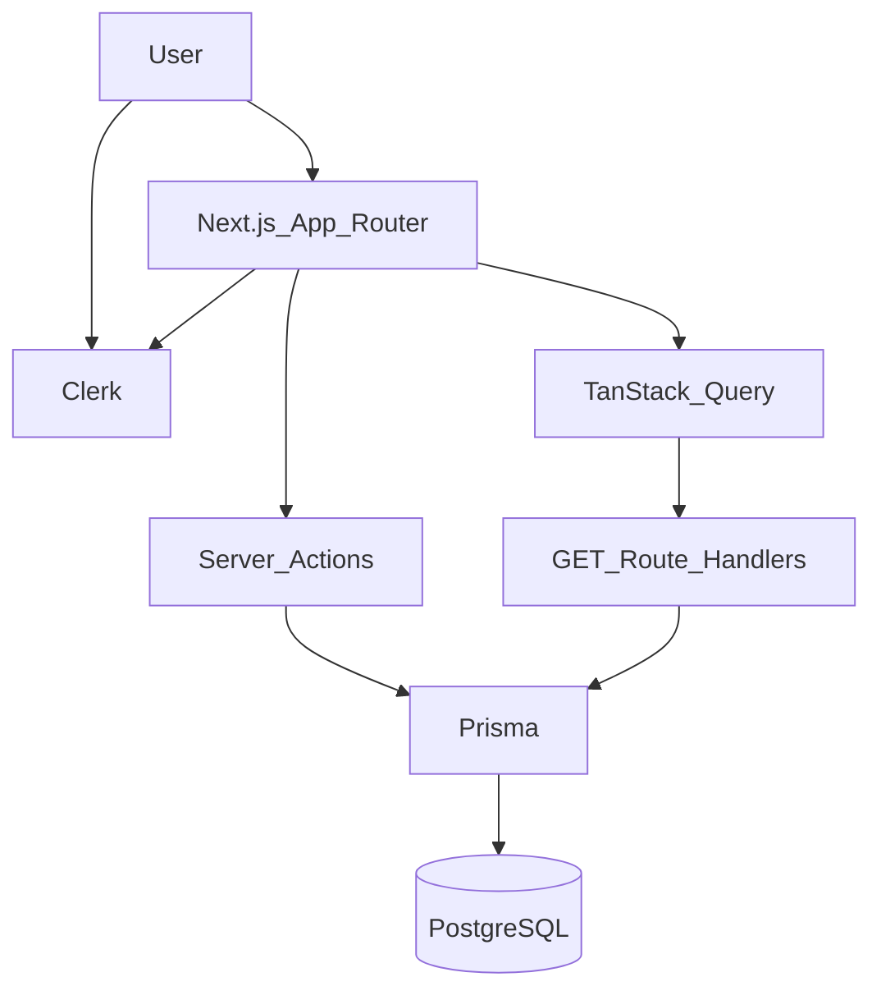

# Application Architecture

**Status:** Living document  
**Last verified:** 27 November 2026 (post WP6)  
**Current runtime:** Next.js 14.2.35 App Router  
**Target runtime:** Next.js 16 (phased; not deployed yet)

Related: [`AGENTS.md`](../../AGENTS.md) · [`TECH_STACK.md`](./TECH_STACK.md) · [Audit](../audit/NEXTJS_APPLICATION_AUDIT.md)

---

## 1. Purpose

Describe how GoodBudget is structured today and how it should evolve during modernization, without requiring a rewrite.

---

## 2. Current architecture

### 2.1 High-level flow



### 2.2 Route map

| URL | File | Rendering |
|-----|------|-----------|
| `/sign-in/[[...sign-in]]` | `app/(auth)/sign-in/...` | Clerk UI |
| `/sign-up/[[...sign-up]]` | `app/(auth)/sign-up/...` | Clerk UI |
| `/` | `app/(dashboard)/page.tsx` | RSC + client children |
| `/transactions` | `app/(dashboard)/transactions/page.tsx` | RSC shell + client island (`TransactionsPageContent`) |
| `/manage` | `app/(dashboard)/manage/page.tsx` | RSC shell + client island (`ManagePageContent`) |
| `/wizard` | `app/wizard/page.tsx` | RSC + client currency UI |
| `/api/*` | `app/api/**/route.ts` | Route Handlers (GET) |

Route groups `(auth)` and `(dashboard)` do not appear in the URL.

### 2.3 Layout hierarchy

```text
app/layout.tsx          ClerkProvider, Inter, Toaster, RootProviders
├── (auth)/layout.tsx   Centered Logo shell
├── (dashboard)/layout.tsx  Navbar + children + requirePageAuth()
└── wizard/layout.tsx   Centered shell + requirePageAuth()
```

### 2.4 Write path (mutations)

Server Actions under:

- `app/(dashboard)/_actions/transactions.ts` — `CreateTransaction`
- `app/(dashboard)/_actions/categories.ts` — `CreateCategory`, `DeleteCategory`
- `app/(dashboard)/transactions/_actions/deleteTransaction.ts` — `DeleteTransaction`
- `app/wizard/_actions/userSettings.ts` — `UpdateUserCurrency`

Pattern: `"use server"` → Zod `safeParse` → `requireActionUser()` → Prisma (often `$transaction` with history aggregates).

### 2.5 Read path

Client components call [`apiGet`](../../lib/api.ts) (`/api/...`) via TanStack Query. Handlers authenticate with `requireApiUserId()` and return **401 JSON** when signed out.

| Endpoint | Role |
|----------|------|
| `/api/user-settings` | Read-only settings (`null` if onboarding incomplete) |
| `/api/categories` | List categories |
| `/api/stats/balance` | Income/expense totals |
| `/api/stats/categories` | Category breakdown |
| `/api/history-data` | Chart series |
| `/api/history-periods` | Available years |
| `/api/transactions-history` | Table rows + formatted amounts |

### 2.6 Domain model (logical)

- **UserSettings** — per Clerk user **base / reporting** currency (wizard + manage). Default for new transactions; not a silent relabel of historical amounts.
- **Category** — unique `(name, userId, type)`; emoji icon.
- **Transaction** — denormalized `category` + `categoryIcon` strings; no Prisma relation to Category. Stores original `amount` + `currency`, plus write-time FX snapshot (`amountInBase`, `fxRate`, `fxRateAt`).
- **MonthHistory / YearHistory** — rollups in **base currency** only; create/delete use `amountInBase`.

Tenant key everywhere: Clerk `userId` string (no FK to Clerk).

**FX:** Server-side rates via [`lib/fx.ts`](../../lib/fx.ts) (Frankfurter by default; optional `FX_API_BASE_URL`). Fail closed on rate fetch failure. Spec: [`docs/superpowers/specs/2026-11-27-multi-currency-design.md`](../superpowers/specs/2026-11-27-multi-currency-design.md).

### 2.7 Providers

[`components/providers/RootProviders.tsx`](../../components/providers/RootProviders.tsx): React Query + `next-themes` + React Query Devtools (always imported today).

---

## 3. Target architecture (Next.js 16 modernization)

Evolve in place:

| Area | Current | Target |
|------|---------|--------|
| Framework | Next 14.2.3 | Next 16 + React 19 |
| Edge auth | Bare `clerkMiddleware()` | Public routes matcher + `auth.protect()` (or Next 16 equivalent) |
| Dashboard pages | Manage/transactions now RSC shells + islands (WP6); home already hybrid | Prefer RSC shells + client islands everywhere |
| API auth errors | `redirect` | `401` JSON for XHR |
| Settings create | GET side effect | Explicit Server Action / POST |
| Money | `Float` | `Decimal` or integer cents |
| Tests | None | Vitest + Playwright + CI |
| Loading/errors | Query skeletons only | `loading.tsx` / `error.tsx` |

Do **not** introduce a second app or Pages Router.

---

## 4. Module ownership

| Area | Location |
|------|----------|
| UI primitives | `components/ui/` (shadcn) |
| App chrome | `components/common/` |
| Feature UI | `app/(dashboard)/_components/`, `.../transactions/_components/` |
| Validation | `schema/` |
| Shared utils | `lib/` |
| DB | `prisma/` |

---

## 5. Invariants (do not break)

1. Every persisted row for a user is scoped by that user's Clerk id.
2. Creating/deleting a transaction keeps `MonthHistory` / `YearHistory` consistent inside a Prisma transaction.
3. Date ranges for overview/history APIs respect `MAX_DATE_RANGE_DAYS` (90).
4. Currency values must be members of `lib/currencies.ts`.
5. History aggregates and overview totals use `amountInBase`; original `amount`/`currency` are preserved for display.

---

## 6. Known architectural gaps

Tracked in the [audit](../audit/NEXTJS_APPLICATION_AUDIT.md): residual gaps include large client bundles and limited automated coverage; manage/transactions CSR shells addressed in WP6 (ARCH-01).
