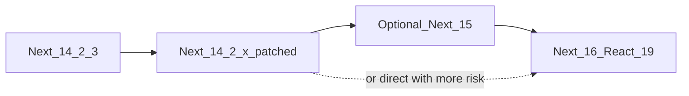

# Dependency Compatibility Report

**Purpose:** Guide the path from the **current** stack (Next 14.2.3 / React 18) to the **target** (Next.js 16 / React 19) without implementing upgrades in this document.

**Last verified:** 27 November 2026 (post-WP1) against lockfile versions.

Related: [`TECH_STACK.md`](../architecture/TECH_STACK.md) · [`MIGRATION_RISK_ASSESSMENT.md`](./MIGRATION_RISK_ASSESSMENT.md) · [`WP1_NEXTJS_SECURITY_UPGRADE_REPORT.md`](./WP1_NEXTJS_SECURITY_UPGRADE_REPORT.md)

---

## Current locked versions (post-WP1)

| Package | Locked | Notes |
|---------|--------|-------|
| `next` | **14.2.35** | Latest 14.2.x; Stage A complete. Residual advisories need 15.5+/16 |
| `react` / `react-dom` | 18.3.1 | Unchanged in WP1 |
| `@clerk/nextjs` | 5.0.3 | Early v5; expect major bump for Next 16 |
| `@prisma/client` | 5.13.0 | Likely OK through Next 15/16 with testing |
| `@tanstack/react-query` | 5.32.1 | React 19 support: verify at upgrade time |
| `eslint-config-next` | **14.2.35** | Aligned with Next in WP1 |
| `typescript` | 5.4.5 | May need newer TS for Next 16 |
| `zod` | 3.x | Fine; audit flagged transitive advisories — re-check |

---

## Recommended upgrade path

### Stage A — Security patch on 14.x (required first)

- **Status: Completed in WP1** — `next@14.2.35`, `eslint-config-next@14.2.35`, React 18.3.1 retained.
- Lint/tsc/build/HTTP smoke passed (see WP1 report).
- **Note:** `npm audit` may still flag `next` for advisories fixed only on 15.5+/16; clearing those is Stage B/C, not a 14.2 patch.

### Stage B — Optional Next 15

- Useful intermediate if Next 16 migration guide is large.
- Adopt React 19 when the chosen Next major requires it.
- Update Clerk to a release that supports that combo.

### Stage C — Next.js 16 (target)

- React **19** required.
- Update `@clerk/nextjs` to the current major that documents Next 16 support.
- Align TypeScript, ESLint flat config if Next 16 scaffolding expects it.
- Review **middleware → proxy** (or equivalent) naming/API changes in official Next 16 docs and apply when upgrading — keep `middleware.ts` until that WP.
- Re-verify Prisma generate on CI Node version.
- Update `docs/architecture/TECH_STACK.md` and `AGENTS.md` “current” tables when Stage C lands.

**Direct 14.2.3 → 16:** Technically possible on a branch, but **high risk**. Not recommended as the documented default.

---

## Compatibility matrix (expected)

| Dependency | Next 14.2 patched | Next 15 | Next 16 |
|------------|-------------------|---------|---------|
| React 18 | Yes | Transitional | No (use React 19) |
| React 19 | Limited / N/A | Yes | Yes |
| Clerk 5.0.3 | Works today | Likely needs bump | **Needs bump** — verify changelog |
| Prisma 5.13 | Yes | Yes* | Yes* |
| TanStack Query 5 | Yes | Yes* | Yes* |
| Tailwind 3 + shadcn | Yes | Yes | Yes* (check RSC guidance) |
| `react-day-picker` v8 | Yes | Check peers | Check peers |
| `next-themes` 0.3 | Yes | Check | Check |

\* Re-verify at upgrade time; mark any breakage in the upgrade PR.

---

## Known coupling risks

| Area | Risk |
|------|------|
| Clerk middleware API | Protect patterns differ across majors |
| Server Actions + React 19 | Keep Next patched for RSC advisories |
| `react-query-devtools` in app import | Listed in devDependencies — fix before strict prod installs |
| Emoji-mart / Recharts | Bundle size; not blockers for Next major |
| Prisma Float money | Independent of Next; migrate separately |

---

## Verification checklist for any upgrade PR

- [ ] `npm ci` / install clean
- [ ] `prisma generate`
- [ ] `npm run lint`
- [ ] `npm run build`
- [ ] Manual: sign-in, wizard, create income/expense, delete, manage category
- [ ] `npm audit` reviewed (no blind `--force`)
- [ ] Docs: TECH_STACK + roadmap status updated

---

## Out of scope for this report

- Pinning exact future version numbers beyond “latest patched on the chosen line” (versions move; verify at execution).
- Executing the upgrades (code change task, not documentation).
